<a href="https://gauravgives.lol">
  <picture>
    <source media="(prefers-color-scheme: dark)" srcset="assets/tape-dark.svg">
    
  </picture>
</a>

☝ this tape re-records itself every day. the right reel fills up as the year goes by and the receipt prints whatever I pushed last.

### hi, I'm Gaurav 🐦

I build AI products end to end and ship them: the agent, the backend it runs on, and the app you hold.

- 🔬 **Research intern @ [LAMIH CNRS](https://www.uphf.fr/lamih)** (France, remote): hourly EV-charging load model, XGBoost over 261k station-hours, R² 0.89 on a held-out test *after* I caught and fixed a time-leaking split.
- 📱 **ex-SWE intern @ AFTR Labs**: built BharatCare's Flutter app and shipped it to the [App Store](https://apps.apple.com/in/app/bharatcare/id6791730391) and [Play Store](https://play.google.com/store/apps/details?id=com.bharatcare.app) in 4 months.
- 🎓 B.Tech CSE @ IIIT Naya Raipur ('28) · 🏆 1st prize, E-Summit 2026
- 🟢 open to **remote internships in 2027**

### the tracklist

<!-- tracklist:start -->
| | track | liner note | plays |
|:--|:--|:--|:--|
| `A1` | [**Phodex**](https://github.com/GAURAV-1313/phodex) | Send coding tasks to Claude Code / Codex from your phone. Nothing merges until you tap approve. Flutter + FastAPI, self-hosted, MIT. | ★ 1 |
| `A2` | [**codecall**](https://github.com/GAURAV-1313/codecall) | Claude Code / Codex plugin that quizzes you on the code your AI just wrote, so you actually own it. | 2,066 installs/yr · ★ 16 |
| `A3` | [**Recall**](https://recall.nofriction.space) | LeetCode tutor whose hints cite problems *you* already solved. | [Chrome Web Store](https://chromewebstore.google.com/detail/recall-for-leetcode/ehflchcddgcnmopbehglnnckjonebfmi) |
| `A4` | [**writeupsc**](https://www.writeupsc.app) | Grades handwritten UPSC answers against 4,552 real topper answers. RAG + handwriting OCR. | 1,000+ sign-ups |
| `A5` | [**Friction**](https://nofriction.space) | Chrome extension that logs a moment of confusion without breaking your flow; Gemini finds the pattern later. | live |
| `B1` | [**Praman Setu**](https://github.com/GAURAV-1313/praman-setu) | Record linkage across Hindi/English spellings for certificate officers. | source |
| `B2` | [**K8sWhisperer**](https://github.com/GAURAV-1313/insiders) | LangGraph agent that spots a broken pod, diagnoses it and fixes the safe cases itself. Risky ones wait for a Slack approval. | source |
| `B3` | [**Roomy**](https://roomy.nofriction.space) | iPhone storage cleaner. SwiftUI, Swift 6, fully on-device. | source |
| `B4` | [**CSC AI Copilot**](https://csc-ai-copilot.vercel.app) | Checks e-District forms before they're submitted. OCR + Gemini. | 🏆 1st, E-Summit '26 |
<!-- tracklist:end -->

### what's on the mixing desk

  
  
  
  
  
  
  
  
  
  
  

### say hi

[gauravgives.lol](https://gauravgives.lol) (the full mixtape, with sound) · [LinkedIn](https://www.linkedin.com/in/gaurav-singh-61a010286) · [X](https://x.com/gauravgives) · [gauravgives@gmail.com](mailto:gauravgives@gmail.com) · [résumé](https://gauravgives.lol/assets/Gaurav-Singh-Resume.pdf)

pressed by [`scripts/build_tape.py`](scripts/build_tape.py) every morning via GitHub Actions. no third-party stats servers, so the tape never 503s.
